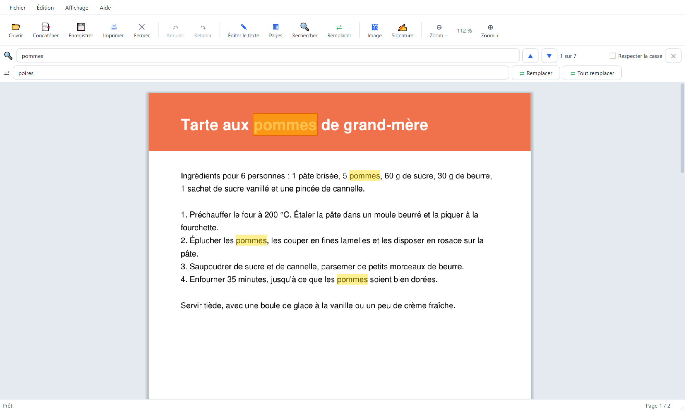

# PDF Toolkit 2

Un éditeur de PDF simple et en français pour Windows : modifier le texte, assembler et organiser les pages,
remplir les formulaires, signer, comparer deux versions d'un document ou d'un plan, rendre un document scanné
cherchable (reconnaissance de texte), créer des planches de photos d'identité, protéger par mot de passe et
compresser vos documents. Tout se passe sur votre ordinateur : aucun document n'est envoyé sur Internet.



## Fonctionnalités

### Lire et naviguer

- **Ouvrir** un PDF par le menu (Ctrl+O), par glisser-déposer dans la fenêtre, ou avec « Ouvrir avec » si
  l'application est installée. Les PDF protégés par mot de passe s'ouvrent après saisie du mot de passe.
- **Zoom** avec Ctrl + molette, autour du point sous la souris, ou Ctrl++ et Ctrl+-. **Aller à une page** : Ctrl+G.
- **Rechercher** (Ctrl+F) : toutes les occurrences sont surlignées ; F3 et Maj+F3 passent à la suivante ou à la
  précédente.
- **Imprimer** (Ctrl+P) : les pages sont ajustées à la feuille, sauf les planches de photos d'identité, imprimées à
  100 % pour garder la taille exacte des photos.

### Modifier le texte

- Passez en **mode édition du texte** (Ctrl+E), puis cliquez sur un texte pour le réécrire sur place. L'ancien texte
  est vraiment retiré du fichier, pas seulement caché.
- La **police d'origine** est gardée quand c'est possible : police intégrée au PDF, ou la même police installée sur
  l'ordinateur. Sinon, une police proche et de mêmes dimensions la remplace.
- **Police d'origine non installée** : un avertissement s'affiche sous le texte en cours d'édition. La fenêtre
  « Infos sur la police » donne tout ce que le PDF en dit (nom exact, style, version, éditeur, créateur, sites,
  licence, lettres disponibles dans le PDF) et des boutons pour la rechercher sur Internet ou sur Google Fonts ;
  une fois installée, elle est prise en compte sans redémarrer.
- **Rechercher et remplacer** (Ctrl+H) : remplacement une par une ou de toutes les occurrences en une fois.

### Rendre un scan cherchable (OCR)

Édition → **Reconnaissance de texte (OCR)** (Ctrl+Maj+O, bouton « OCR »). Le texte des pages scannées est lu sur
l'image, puis posé dessus en **calque invisible**, mot par mot, à la place de chaque mot : la page garde son aspect,
mais son texte se **cherche** (Ctrl+F, accents compris), se **sélectionne** et se **copie** dans n'importe quel
lecteur de PDF, et le calque est gardé à l'enregistrement. Rien n'est envoyé : la lecture se fait sur l'ordinateur,
avec le moteur Tesseract intégré à l'application.

- **Pages** : toutes, ou une liste (« 1-3, 7 ») ; **langue** : français (par défaut), anglais, ou les deux.
- **Ignorer les pages qui contiennent déjà du texte** (coché) : les pages déjà lisibles, ou déjà passées à l'OCR,
  sont laissées telles quelles. Décochée, une page déjà passée à l'OCR est relue : son ancien texte reconnu est
  remplacé, jamais ajouté en double.
- **Redresser les pages scannées à l'envers ou d'un quart de tour** (coché) : une page qui se lit mal est essayée
  dans les quatre sens, puis pivotée pour s'afficher à l'endroit.
- La progression s'affiche page par page. **Annuler** arrête la lecture à la fin de la page en cours : les pages
  déjà lues gardent leur texte, et relancer l'OCR reprend où elle s'était arrêtée. **Ctrl+Z** annule toute
  l'opération d'un coup.
- À la fin, **Copier le texte** ou **Enregistrer en .txt** le texte reconnu, page par page.
- En mode édition, le texte reconnu, encadré en pointillés gris, **ne se modifie pas** : il est invisible, et un texte
  réécrit s'afficherait par-dessus l'image. « Rechercher et remplacer » le laisse aussi tel quel. Pour le corriger,
  refaites l'OCR de la page.

### Remplir, signer, insérer

- **Formulaires** : zones de texte, cases à cocher, cases rondes à choix unique (« ○ Oui ● Non ») et listes de choix
  se remplissent directement sur la page.
- **Images et signatures** (Ctrl+I, Ctrl+Maj+I) : insérez une image, placez-la et redimensionnez-la à la souris. Le
  fond blanc d'une signature scannée devient transparent.
- **Formats de photo** : JPEG, PNG, **HEIC et HEIF** (photos d'iPhone et de certains Android), WebP, GIF, BMP et TIFF.
  Une photo prise en hauteur est insérée droite. Un JPEG est inséré tel quel, sans perte. Une photo HEIC ou WebP est
  mise dans le PDF en JPEG, ou en PNG si elle a des transparences. Le format AVIF n'est pas pris en charge (la
  version web le lit).

### Organiser et assembler

- **Organiser les pages** (Ctrl+R) : sélectionnez des pages au clic gauche, déplacez-les en les faisant glisser avec
  le clic droit, faites-les pivoter ou supprimez-les. Un clic droit sur une page du document propose aussi la rotation
  et la suppression.
- **Concaténer des PDF** (Ctrl+M) : assemblez plusieurs fichiers dans l'ordre de votre choix. Un PDF glissé sur le
  document ouvert est ajouté à la fin.
- **Annuler et rétablir** (Ctrl+Z, Ctrl+Y) chaque opération, jusqu'à 50 étapes en arrière.

### Comparer deux PDF

Fichier → **Comparer deux PDF** (Ctrl+Maj+C). Le document ouvert, avec ses modifications, est proposé comme version A
(l'ancienne) ; choisissez la version B (la nouvelle), puis cliquez sur **Comparer**. **Inverser** échange les deux.

- **Ce qui est comparé** : le texte mot à mot (mots ajoutés en vert, supprimés en rouge, modifiés en orange) et
  l'aspect des pages, pixel par pixel et en couleurs (images, dessins, surlignages, couleur du texte : encadrés en
  violet). Les pages ajoutées ou supprimées sont repérées sans décaler la suite, et un paragraphe qui passe simplement
  à la page suivante n'est pas compté comme une différence.
- **Deux affichages** : **côte à côte**, avec défilement et zoom synchronisés, ou **superposées** : les deux versions
  en une seule page, ce qui n'est que dans l'ancienne en rouge, ce qui n'est que dans la nouvelle en vert, ce qui
  est commun en noir. Passer de l'un à l'autre garde l'endroit regardé.
- **La liste des différences**, regroupées par page avec leur nombre par type, mène directement à chacune ; F3 et
  Maj+F3 passent à la suivante ou à la précédente.
- **Réglages** :
  - **Document** (par défaut) : pour les textes, contrats, devis… avec une tolérance visuelle de 10 %, qui ignore le
    bruit d'une image recompressée.
  - **Plan technique (circuit, dessin)** : pour les plans et les circuits imprimés, par exemple des couches Gerber
    imprimées en PDF. La comparaison est deux fois plus fine et la tolérance de 5 % : une piste décalée de quelques
    centièmes de millimètre ou un via agrandi sont trouvés, et deux changements voisins restent séparés. Chaque
    changement est situé en millimètres depuis le coin de la page, et les couches (F.Cu, B.Cu, In1.Cu, Top Layer,
    Edge.Cuts…) sont reconnues et nommées.
  - Options : ignorer les majuscules, ignorer la ponctuation, comparer le texte seul ou l'aspect seul, tolérance
    visuelle réglable.
- **Rapport PDF** : synthèse, liste numérotée des différences, pages des deux versions annotées, puis un **gros plan**
  de chaque différence (ancienne version, nouvelle version et superposition).
- **PDF scannés** (sans texte) : ils sont comparés par leur aspect seulement.

### Photos d'identité

Fichier → **Photos d'identité** (Ctrl+Maj+P), à partir d'une photo (JPEG, PNG, HEIC et HEIF des iPhone, WebP, BMP,
GIF ou TIFF) :

- sélectionnez la zone (cadre aux bonnes proportions, ovale du visage), zoomez, tronquez, pivotez, redressez, réglez
  la luminosité et le contraste ;
- choisissez le format (France et Union européenne, Royaume-Uni, États-Unis, Canada, Chine, Japon, Australie ou sur
  mesure) et le papier (10 × 15 cm, 13 × 18 cm, A6, A5, A4, Lettre ou sur mesure) ;
- le PDF porte autant de photos que la feuille peut en contenir, ou le nombre demandé, et s'imprime à leur **taille
  exacte**, sans mise à l'échelle. La marge et l'espacement ne changent que le nombre de photos, jamais leur taille.

Une planche enregistrée se modifie ensuite (« Modifier la planche de photos », Ctrl+Maj+M) : la photo entière et les
réglages sont joints au PDF, sauf si vous décochez cette option avant de transmettre le fichier.

### Protéger et alléger

- **Mot de passe** (Fichier → Protéger par mot de passe) : protection par chiffrement AES 256 bits, ou retrait de la
  protection d'un PDF ouvert avec son mot de passe.
- **Compression à l'enregistrement** : sans perte, ou forte pour l'envoi par e-mail (images recompressées en JPEG et
  ramenées à environ 150 ppp si elles sont très détaillées).

### Raccourcis clavier

| Action | Raccourci |
|---|---|
| Ouvrir, enregistrer, enregistrer sous | Ctrl+O, Ctrl+S, Ctrl+Maj+S |
| Fermer le document, quitter | Ctrl+W, Alt+F4 |
| Imprimer | Ctrl+P |
| Annuler, rétablir | Ctrl+Z, Ctrl+Y |
| Mode édition du texte | Ctrl+E |
| Rechercher, rechercher et remplacer | Ctrl+F, Ctrl+H |
| Occurrence ou différence suivante, précédente | F3, Maj+F3 |
| Zoom avant, arrière | Ctrl++, Ctrl+- (ou Ctrl + molette) |
| Aller à la page | Ctrl+G |
| Organiser les pages | Ctrl+R |
| Concaténer des PDF | Ctrl+M |
| Insérer une image, une signature | Ctrl+I, Ctrl+Maj+I |
| Comparer deux PDF | Ctrl+Maj+C |
| Reconnaissance de texte (OCR) | Ctrl+Maj+O |
| Photos d'identité, modifier une planche | Ctrl+Maj+P, Ctrl+Maj+M |

### Limites connues

- **Modification du texte** : le nouveau texte reste sur la ligne d'origine, sans retour à la ligne automatique. Une
  police absente du PDF et de l'ordinateur est remplacée par une police proche.
- **Comparaison** :
  - un texte déplacé loin de sa place apparaît comme une suppression et un ajout ;
  - des pages simplement interverties sont signalées comme ajoutées, supprimées ou décalées, pas comme « déplacées » ;
  - le texte d'un PDF scanné n'est comparé qu'après sa reconnaissance de texte (OCR) ; sans elle, seul son aspect
    l'est ;
  - en réglage Document, un changement de moins d'un dixième de millimètre peut passer inaperçu : utilisez le réglage
    Plan technique pour les dessins fins ;
  - la superposition compare les pages en niveaux de gris : un simple changement de couleur s'y voit mal, mais il est
    signalé dans la liste.
- **Reconnaissance de texte (OCR)** :
  - texte imprimé seulement, en français ou en anglais : l'écriture manuscrite n'est pas lue, et un scan flou, très
    incliné ou de basse résolution (moins de 200 ppp) donne plus d'erreurs. Sur des scans d'essai à 300 ppp,
    bruités et inclinés d'un demi-degré, environ 2 % des caractères sont faux (accents compris) ;
  - chaque page est lue en une seconde environ, pendant laquelle la fenêtre attend la fin de la page (PyMuPDF garde
    la main pendant le calcul) ; elle se met à jour entre deux pages ;
  - le texte vertical (sur une page tournée qu'on choisit de ne pas redresser) n'est pas reconnu ;
  - le calque d'OCR posé par un autre logiciel est gardé : relire une telle page, case « Ignorer… » décochée, ajoute
    le texte de PDF Toolkit 2 à côté du sien.

## Utiliser l'application

Téléchargez `PDF Toolkit 2.exe` depuis la page **Releases** de ce dépôt et lancez-le : rien à installer.

> Windows peut afficher « Windows a protégé votre ordinateur », car l'exécutable n'est pas signé numériquement.
> Cliquez sur **Informations complémentaires**, puis sur **Exécuter quand même**.

## Lancer depuis le code source

Développé et testé sous Windows avec Python 3.15, PySide6 6.12 et PyMuPDF 1.28.

```
pip install PySide6 pymupdf pillow pillow-heif
python main.py
```

Pillow et pillow-heif ne servent qu'aux photos WebP et HEIC : sans eux, l'application fonctionne et le dit quand on
choisit une telle photo.

Un PDF peut aussi être passé en argument : `python main.py document.pdf`.

## Construire l'exécutable

```
pip install pyinstaller
python -m PyInstaller --clean "PDF Toolkit 2.spec"
```

Le résultat est `dist\PDF Toolkit 2.exe`, un seul fichier sans console, avec les données de langue de l'OCR
(dossier `tessdata`, dont la recette vérifie l'empreinte SHA-256). Il n'est pas compressé avec UPX : sur
d'autres PC, les antivirus bloquaient les DLL compressées et l'application ne démarrait pas
(« No module named 'PySide6.QtCore' »).

Essai de la reconnaissance de texte, sur des scans de synthèse (aucun document personnel) : précision, recherche,
sélection et copie, enregistrement, OCR refaite sans doublon, pages pivotées ou tournées, interface sans écran.

```
python tests/essai_ocr.py                                  # depuis le code source
python tests/essai_ocr.py --exe "dist/PDF Toolkit 2.exe"   # dans l'exécutable construit
```

L'exécutable accepte aussi `--ocr entrée.pdf sortie.pdf [fra|eng|fra+eng]` : il lit alors le texte de toutes les
pages sans ouvrir de fenêtre (réglages par défaut), ce qui sert à cet essai et au traitement par lots.

L'icône `PDF Toolkit 2.ico` est générée par `python make_icon.py` (à relancer seulement si son dessin change).
Le nom et la version de l'exécutable (Propriétés → Détails) sont lus dans `main.py` (`APP_NAME`, `APP_VERSION`).

### Installateur

L'installateur (Inno Setup 6) installe la version « en dossier » de l'application, qui n'extrait rien au
lancement : c'est la version recommandée, la moins souvent bloquée par les antivirus.

```
$env:CONSTRUCTION = "dossier"
python -m PyInstaller --clean --noconfirm "PDF Toolkit 2.spec"
ISCC "installer\PDF Toolkit 2.iss"
```

Le résultat est `dist\PDF-Toolkit-2-Installation-<version>.exe` : installation sans droits d'administrateur,
raccourcis dans le menu Démarrer (et sur le Bureau au choix), option « Ouvrir avec » pour les fichiers PDF (sans
changer le lecteur par défaut), désinstallation par Paramètres → Applications.

Les exécutables publiés sont construits par GitHub Actions (`.github/workflows/build.yml`) à partir du code de ce
dépôt, avec les versions de `requirements-build.txt` : il suffit de pousser une étiquette `v1.1`, `v1.2`… pour
construire, signer et publier une nouvelle Release.

## Politique de signature du code

Signature de code gratuite fournie par [SignPath.io](https://about.signpath.io/), certificat par
[SignPath Foundation](https://signpath.org/).
*(Free code signing provided by SignPath.io, certificate by SignPath Foundation.)*

- **Contributeurs et relecteurs** : [Yannick Buchet](https://github.com/yannickbuchet-ctrl)
- **Approbateur des signatures** : [Yannick Buchet](https://github.com/yannickbuchet-ctrl)

Seuls les exécutables construits par GitHub Actions à partir du code public de ce dépôt sont signés.

**Confidentialité** : ce programme ne transmet aucune information à d'autres systèmes en réseau, sauf demande
expresse de l'utilisateur. *(This program will not transfer any information to other networked systems unless
specifically requested by the user or the person installing or operating it.)*

## Fichiers

| Fichier | Rôle |
|---|---|
| `main.py` | l'application |
| `make_icon.py` | génère l'icône de l'exécutable |
| `PDF Toolkit 2.spec` | recette de construction de l'exécutable (PyInstaller) |
| `installer/PDF Toolkit 2.iss` | script de l'installateur (Inno Setup) |
| `requirements-build.txt` | versions des outils de construction |
| `tessdata/` | données de langue de la reconnaissance de texte (français, anglais) et leur licence |
| `tests/essai_ocr.py` | essai de la reconnaissance de texte, depuis le code source ou dans l'exécutable |
| `.github/workflows/build.yml` | construction, signature et publication automatiques |
| `PDF Toolkit 2.ico` | icône |
| `captures/` | captures d'écran de ce README |

## Licence

PDF Toolkit 2 est distribué sous la licence **GNU AGPL v3** (voir [LICENSE](LICENSE)).
Ce choix est imposé par [PyMuPDF](https://pymupdf.readthedocs.io/), qui lit et écrit les PDF et est lui-même
sous licence AGPL : toute personne qui distribue ce logiciel, modifié ou non, doit aussi en publier le code source.

### Données de la reconnaissance de texte

Le moteur [Tesseract](https://github.com/tesseract-ocr/tesseract) (Apache 2.0) est intégré à PyMuPDF. Ses données
de langue, dans `tessdata/`, sont les modèles « best_int » : les réseaux de
[tessdata_best](https://github.com/tesseract-ocr/tessdata_best) (Google, licence Apache 2.0, texte dans
`tessdata/LICENSE`) convertis en entiers par le projet Tesseract.js (paquets npm `@tesseract.js-data/fra` et
`@tesseract.js-data/eng` 1.0.0, dossier `4.0.0_best_int`). Sur des scans d'essai, ils font autant d'erreurs que
tessdata_best (2,2 % des caractères en français, contre 3,1 % pour tessdata_fast), à la vitesse de tessdata_fast.

| Fichier | Taille | SHA-256 |
|---|---|---|
| `fra.traineddata` | 1,2 Mo | `bf83833fa957ff0076f6aa93f69e3bdf7b014dea829ea0c0d6be6b48a3ceef6d` |
| `eng.traineddata` | 5,0 Mo | `5dc5d8d640a212c9d6184921ba103b186f50e0fed9ee716c53e6b312b400d747` |

## Crédits

- Application écrite par **Claude Code** (Claude Opus 5.5) sous la direction de **Yannick Buchet**.
- Reconnaissance de texte : [Tesseract](https://github.com/tesseract-ocr/tesseract), intégré à PyMuPDF, et ses données
  de langue (Apache 2.0).
- [PyMuPDF](https://pymupdf.readthedocs.io/) (AGPL) pour le traitement des PDF,
  [PySide6 / Qt](https://doc.qt.io/qtforpython/) (LGPL) pour l'interface.
- Photos WebP et HEIC : [Pillow](https://python-pillow.github.io/) (licence MIT-CMU) et
  [pillow-heif](https://github.com/bigcat88/pillow_heif) (BSD 3 clauses), qui embarque
  [libheif](https://github.com/strukturag/libheif) et [libde265](https://github.com/strukturag/libde265)
  (struktur AG, LGPL v3) et l'encodeur [x265](https://www.x265.org/) (GPL v2 ou ultérieure), dont libheif ne peut se
  passer. Toutes ces licences sont compatibles avec l'AGPL v3 de l'application.
